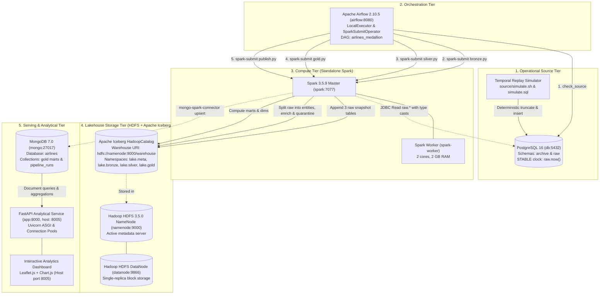

# Architecture & Topology

Container topology, network, and port layout for the Airlines Medallion Lakehouse. See [PIPELINE.md](PIPELINE.md) for data flow and transformation logic, [DASHBOARD.md](DASHBOARD.md) for the UI.

## Table of Contents

- [Architecture \& Topology](#architecture--topology)
  - [Table of Contents](#table-of-contents)
  - [Core Components \& Functional Roles](#core-components--functional-roles)
  - [Docker Network Topology (`ktdl-network`) \& Port Allocation](#docker-network-topology-ktdl-network--port-allocation)
  - [Security \& Isolation Rationale](#security--isolation-rationale)

---

## Core Components & Functional Roles

1. **PostgreSQL 16 (`db`)**: operational source, 3 raw tables (`flight_seat_reservations`, `airport_sites`, `aircraft_seat_layouts`). Schema `archive` = full history; schema `raw` = point-in-time snapshot governed by `raw.now()`.
2. **Apache Airflow 2.10.5 (`airflow`)**: DAG `airlines_medallion`, `LocalExecutor`, metadata in the `airflow` Postgres database. `PythonOperator` for the source check, `SparkSubmitOperator` for each pipeline stage.
3. **Apache Spark 3.5.9 (`spark`, `spark-worker`)**: standalone cluster (`spark://spark:7077`). Packages: `iceberg-spark-runtime-3.5_2.12:1.10.0`, `mongo-spark-connector_2.12:10.4.1`, `postgresql:42.7.4`.
4. **Hadoop HDFS 3.5.0 (`namenode`, `datanode`)**: backs Iceberg storage at `hdfs://namenode:9000/warehouse`. Single-replica (demo scale, not fault tolerant).
5. **Apache Iceberg**: table format on Parquet - ACID `MERGE INTO`, schema/partition evolution, snapshot isolation.
6. **MongoDB 7.0 (`mongo`)**: serves pre-aggregated Gold marts and `pipeline_runs` to the API.
7. **FastAPI (`app`)**: REST (`/api/marts/*`, `/api/summary`, `/api/airports`, `/api/routes`, `/api/runs`) and the static dashboard (`dashboard.html/js/css`, Leaflet + Chart.js).

---

## Docker Network Topology (`ktdl-network`) & Port Allocation

All containers share a Docker bridge network, `ktdl-network`:

| Container | Image | Host Port | Internal Port | Protocol / Purpose |
|---|---|---|---|---|
| `db` | `postgres:16` | **5432** | 5432 | PostgreSQL engine (demo OLTP & airflow metadata) |
| `adminer` | `adminer:latest` | **8082** | 8080 | PostgreSQL Administration UI |
| `mongo` | `mongo:7.0` | _None_ | 27017 | MongoDB document store engine |
| `mongo-express` | `mongo-express:latest` | **8081** | 8081 | MongoDB Administrative Web Console |
| `namenode` | `apache/hadoop:3.5.0` | **9870** | 9000 / 9870 | Port 9000: HDFS RPC protocol; Port 9870: WebHDFS UI |
| `datanode` | `apache/hadoop:3.5.0` | _None_ | 9866 / 9864 | Port 9866: HDFS Data transfer; Port 9864: DataNode HTTP |
| `spark` | `apache/spark:3.5.9` | **8080** | 7077 / 8080 | Port 7077: Spark Master RPC; Port 8080: Master Web UI |
| `spark-worker` | `apache/spark:3.5.9` | _None_ | 8081 | Spark Worker Web UI |
| `spark-stream` | `apache/spark:3.5.9` | _None_ | - | Streaming consumer (opt-in, see `start-streaming.sh`) |
| `kafka-0` | `apache/kafka:latest` | _None_ | 9092 | Single-broker KRaft cluster (opt-in) |
| `airflow` | `ktdl-airflow:2.10.5` | **8083** | 8080 | Airflow Standalone Webserver & Scheduler UI |
| `app` | `ktdl-service-main:latest` | **8000** | 8000 | FastAPI REST service & Interactive Dashboard |
| `dbt-docs` | `ktdl-dbt-docs:1.0.0` | **8085** | 80 | dbt lineage/docs UI (opt-in, see `start-admin-uis.sh`) |

`./start-all.sh` brings up the core pipeline only. `./start-admin-uis.sh` and `./start-streaming.sh` bring up the rest on demand - see the repo root README for why.

---
